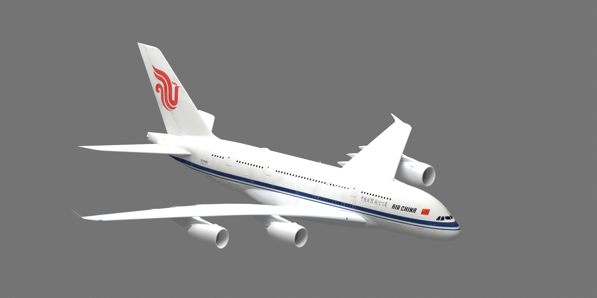
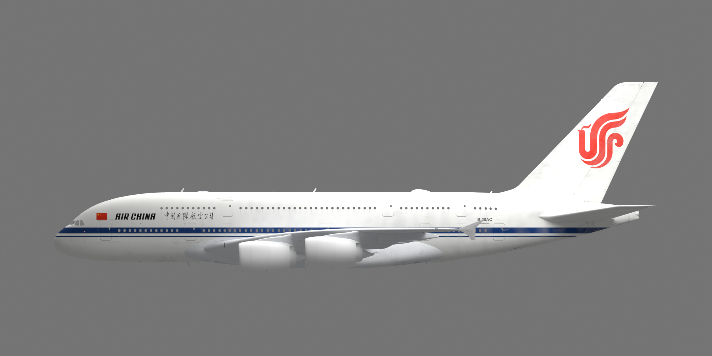
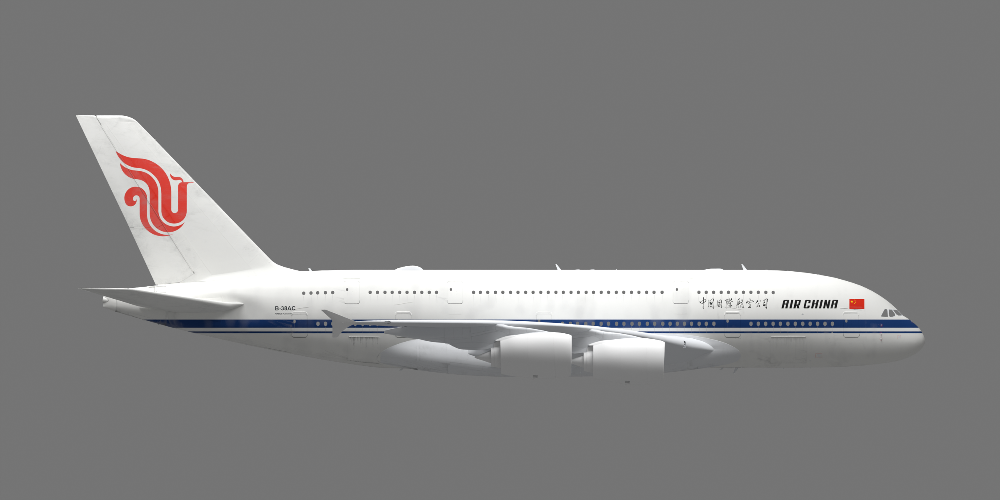

# Air China Fictional — FlyByWire A380X

微软模拟飞行2024中的中国国际航空虚拟涂装，使用经典白机身、蓝色腰线和红凤凰尾标，配有中英文题字、国旗及驾驶舱机号铭牌。**B-38AC为虚构注册号，本项目中的国航A380涂装为虚拟设计。**

**当前版本：0.1.1。用户已在MSFS2024游戏内完成测试，确认本版涂装正常显示并可发布。** GitHub发布者为 **PYZX159**；已验证安装包保留原制作署名Eason。

以上及下方图片均为使用官方paintkit模型、最终源贴图生成的Blender渲染预览。游戏内测试状态以用户实际验证为依据。

## 下载与安装

- [成品ZIP：AirChina-FBW-A380X-Stable-v0.1.1.zip](https://github.com/PYZX159/airchina-fbw-a380x/releases/download/v0.1.1/AirChina-FBW-A380X-Stable-v0.1.1.zip)
- [完整可安装目录](package/airchina-fbw-a380x-stable)
- [Release下载页](https://github.com/PYZX159/airchina-fbw-a380x/releases)

1. 退出模拟器，解压成品ZIP。
2. 将其中整个`airchina-fbw-a380x-stable`文件夹放入当前启用的Community目录；更新时覆盖原同名涂装目录。
3. 确认该文件夹内直接包含`manifest.json`、`layout.json`和`SimObjects`。
4. 启动MSFS2024，在FBW A380X涂装列表选择 **Air China Fictional - B-38AC**。

请下载上述成品ZIP，或使用`package/`内的安装目录。GitHub的“Download ZIP”下载的是整个源码仓库。

## 兼容版本

已验证的基础机模是 **FlyByWire A380X Stable 2024.1.0**，运行于 **Microsoft Flight Simulator 2024**。安装包依赖`flybywire-aircraft-a380-842`，使用`FlyByWire_A380_842`的Stable变体结构。请先通过FBW Installer安装对应基础机模。

本包未编译为新版Native2024模块化机型的安装格式。仓库不包含基础机模、系统、音效或驾驶舱模型。

0.1.1补齐了9个MSFS `.DDS.json`贴图描述文件，解决初版粉紫棋盘格问题；本次公开发布保留用户已验证的9张DDS贴图原件。

## 预览

## 制作源码

涂装由GIMP后台批处理制作及导出，使用Blender后台进行UV投影和paintkit模型预览。

| 路径 | 内容 |
| --- | --- |
| `artwork/final/` | 9张最终PNG源贴图 |
| `artwork/projection/` | 两侧投影PNG与坐标说明 |
| `artwork/baked/` | 机身UV投影PNG |
| `resources/airchina/` | 制作使用的3个品牌SVG及来源记录 |
| `geometry/` | Blender投影、检查与预览脚本 |
| `package/airchina-fbw-a380x-stable/` | 已验证的完整安装包 |

完整GIMP原件通过[Release源码附件](https://github.com/PYZX159/airchina-fbw-a380x/releases/download/v0.1.1/AirChina-FBW-A380X-GIMP-Sources-v0.1.1.zip)提供：包含9张最终UV贴图XCF和2张侧面投影母版XCF。下载后**解压至仓库根目录**，保留`artwork/xcf/`和`artwork/projection/`目录结构。所有XCF均不存放于普通Git历史，原始分层文件不经压缩重存。

编辑、从XCF导出及重新制作所需的依赖和命令见[SOURCE-BUILD.md](SOURCE-BUILD.md)。原始FBW paintkit的PSD、FBX、OBJ及几何缓存未随仓库提供；从既有XCF导出无需这些几何文件。

## 素材与署名

本项目为非官方虚拟涂装。国航名称、标志和题字归相应权利人所有；FlyByWire与Airbus相关素材亦保留各自权利。本仓库没有将第三方商标、paintkit或衍生图层声明为可自由再授权的素材。

品牌文件的来源及使用说明见[素材来源记录](resources/airchina/SOURCES.md)，其他第三方素材说明见[THIRD-PARTY-NOTICES.md](THIRD-PARTY-NOTICES.md)。
